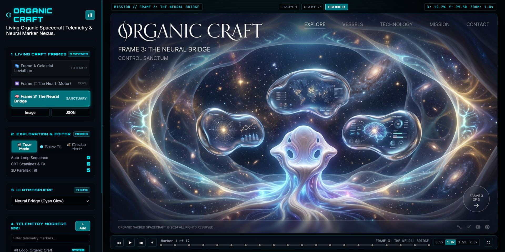

<div align="center">
  <h1>🌌 Organic Craft: Next-Gen Neural Telemetry Nexus</h1>
  <p><strong>A High-Tier, Interactive, Audio-Synthesized Biomechanical Exploration Suite</strong></p>
  <p><a href="https://github.com/plantacerium/Organic-Craft-Markers">https://github.com/plantacerium/Organic-Craft-Markers</a></p>
</div>



---

## 🚀 Overview

**Organic Craft - Neural Telemetry Nexus** is a state-of-the-art interactive image marker, telemetry analyzer, and cinematic storytelling engine. Powered by **GSAP 3**, **Web Audio API procedural sound synthesis**, **HTML5 Canvas stardust physics**, and **Glassmorphism 2.0**, it transforms static imagery into a living, breathing spaceship dashboard.

Whether you're exploring deep space leviathans, analyzing biometric core motors, or building your own custom telemetry overlays, the platform delivers zero-friction immersion right in the browser.

---

## ✨ Cutting-Edge Immersion & Features

### 🎧 Procedural Web Audio Synthesizer (`NeuralAudio`)
- **Zero External Dependencies**: 100% synthesized in real time via the browser's native **Web Audio API**.
- **Binaural Cosmic Drone**: Subtle 55Hz low-pass sine drone generating an atmospheric deep-space acoustic cushion.
- **Holographic Chimes & Blips**: Dynamic frequency chirps when markers illuminate or cards open.
- **Synaptic Laser Zaps**: Electric audio frequency sweeps when SVG neural links connect.
- **Sub-Bass Zoom Booms**: Cinematic low-frequency impacts when focusing on high-threat or critical systems.
- **Equalizer Waveform Visualizer**: Real-time animated audio toggle in the HUD header with instant mute shortcut (`M`).

### 🌌 Organic Craft Living Frames Switcher
Instantly jump between the 3 main anatomical frames with one click in the sidebar or the top HUD pills:
1. 🌌 **Frame 1: Celestial Leviathan** (`organic_craft_frame_1_celestial_leviathan.png` + `organic_craft_frame_1.json`) — Exterior biological hull, Flower of Life mandala eye, solar tendrils, and constellation telemetry.
2. ⚛️ **Frame 2: The Heart (Motor)** (`organic_craft_frame_2_the_pulsing_core.png` + `organic_craft_frame_2.json`) — Contained singularity vortex, runic gyroscopic rings, translucent bone-cage, and biometric resonance meters.
3. 🧠 **Frame 3: The Neural Bridge** (`organic_craft_frame_3_the_neural_bridge.png` + `organic_craft_frame_3.json`) — Bridge command sanctuary, pilot spinal link throne, terrestrial holomap, proximity radar, and living data tendrils.

### 🎮 Tactical Exploration & Expanded Creator Modes
- 🎬 **Tour Mode (Cinematic)**: Plays the full automated sequence with camera zooms, staggered neural link draws, and synchronized ambient lighting. Supports auto-looping.
- 🌐 **Show All (Tactical Overview)**: Renders all markers and neural connections simultaneously for free manual exploration.
- 🛠️ **Expanded Creator & Pin Mode**: Full authoring suite!
  - Click anywhere on the visual stage to place new telemetry markers.
  - Click on any existing marker to edit all properties or **Delete** it.
  - **Drag and Drop markers** directly on the canvas to visually reposition them in real time with live SVG line updates.
  - Add and manage multiple telemetry `data_points` with dynamic status tags (`optimal`, `stable`, `warning`, `critical`).
  - Configure zoom levels, step duration, and custom `connects_to` network topologies.
  - Download the modified schema with **Export JSON** or use **Copy JSON** for instant clipboard sharing.

### 🕹️ Interactive HUD & Scrubber Timeline
- **Timeline Scrubber**: Clickable pip markers allow jumping directly to any step.
- **Speed Controls**: Select playback rate on the fly (`0.5x`, `1.0x`, `1.5x`, `2.0x`).
- **Targeting Reticle**: Smooth crosshair cursor tracking with real-time coordinate readouts (`X: ##.#%`, `Y: ##.#%`).
- **Sci-Fi Corner Brackets & CRT Scanline Filter**: Optional toggleable retro-futuristic CRT scanlines and vignette.
- **3D Parallax Tilt**: Gyroscopic mouse tilt effect providing tangible 3D depth to the viewport.
- **Cosmic Bio-Spore Particles**: 60+ floating stardust canvas particles that gently deflect around user cursor movements.

### 🎨 Multi-Atmosphere Theme Engine
Five distinct CSS custom property themes:
- 🔵 **Neural Bridge (Default)**: Cyan & deep-space navy.
- 🟡 **Solar Singularity**: Golden amber & warm sacred-geometry glow.
- 🔴 **Bio-Hazard**: Crimson warning alert matrix.
- 🟢 **Void Matrix**: Monospace terminal hacker green.
- ⚪ **Quantum Core**: Ultra-luxurious monochrome minimalism.

---

## ⚡ Tactical Keyboard Hotkeys

| Key | Action |
| :--- | :--- |
| <kbd>SPACE</kbd> | Play / Pause sequence |
| <kbd>←</kbd> / <kbd>→</kbd> | Jump to Previous / Next Marker |
| <kbd>1</kbd> / <kbd>2</kbd> / <kbd>3</kbd> | Quick load Frame 1, Frame 2, or Frame 3 |
| <kbd>M</kbd> | Toggle Web Audio Synthesizer (Mute / Unmute) |
| <kbd>F</kbd> | Toggle Stage Fullscreen |
| <kbd>O</kbd> | Toggle Tactical Overview Mode (Show All) |
| <kbd>C</kbd> | Toggle Pin / Marker Creator Mode |
| <kbd>R</kbd> | Reset Camera View & Zoom |
| <kbd>ESC</kbd> | Close Modals & Overlays |

---

## 🛠️ Quick Launch

### Option A: Node.js
```bash
npx serve .
```
Open `http://localhost:3000` in your browser.

### Option B: Python
```bash
python -m http.server 8000
```
Open `http://localhost:8000` in your browser.

*(If opening offline via `file:///`, the custom file uploader and built-in fallback modes ensure smooth operation regardless of CORS restrictions.)*

---

## 📐 Data Architecture (JSON Schema)

The visualizer dynamically generates cards, lines, radar rings, and telemetry tables from modular JSON files:

```json
{
    "scene_name": "Organic Node - Singularity Core",
    "markers": [
        {
            "id": "m1",
            "x": 50,
            "y": 50,
            "label": "Singularity Core",
            "description": "Primary propulsion and life-support generator.",
            "duration": 4,
            "category": "power",
            "zoom": 1.4,
            "connects_to": ["m2", "m3"],
            "data_points": [
                {"label": "Warp Output", "value": "1.21 GW", "status": "optimal"},
                {"label": "Containment", "value": "Stable", "status": "stable"}
            ]
        }
    ]
}
```

### Supported Properties:
- `id` *(String)*: Unique marker identifier.
- `x`, `y` *(Number)*: Relative position percentage (0–100%).
- `label` *(String)*: Marker headline title.
- `description` *(String)*: In-depth technical note or readout.
- `duration` *(Number)*: Auto-tour duration in seconds.
- `category` *(String)*: `system`, `critical`, `environment`, `power`, or `navigation`.
- `zoom` *(Number)*: Camera zoom factor (e.g. `1.3` = 130%).
- `connects_to` *(Array)*: IDs of connected nodes for SVG neural link animation.
- `data_points` *(Array)*: Telemetry key-values with status badges (`optimal`, `stable`, `warning`, `critical`).

---

<div align="center">
  <sub>Built for next-gen interactive web storytelling & technical visualization.</sub><br>
  <strong>Organic Craft © 2026</strong>
</div>
